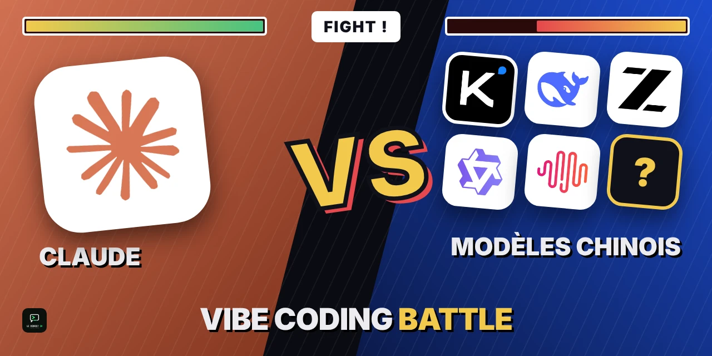

  

  <b>One brief. Several AIs. Real, playable results.</b> 
  Claude takes on Chinese open-source models, one concrete task at a time.

  <a href="https://www.tiktok.com/@ledebriefia"><b>Follow the battles on TikTok: @ledebriefia</b></a>

---

Vibe Coding Battle is a series from [**Le Débrief IA**](https://www.tiktok.com/@ledebriefia), my TikTok channel about AI. Every model gets the same brief, and every result lives here in its own repo. No benchmark charts: clone it, run it, and judge for yourself.

## The rounds

| Round | The challenge | Claude | Challengers |
|---|---|---|---|
| **4** 🔥 | Real-time card duel, Clash Royale style | [Fracas](https://github.com/vibecoding-battle/round-4-claude) · [Guerre des Marges](https://github.com/vibecoding-battle/round-4-claude-extra) | [Nexus Arena](https://github.com/vibecoding-battle/round-4-kimi) (Kimi) |
| **3** | Interactive generative web experience | [HOULE](https://github.com/vibecoding-battle/round-3-claude) | [AION](https://github.com/vibecoding-battle/round-3-kimi) (Kimi) |
| **2** | Interactive 3D aerial view of Paris | [Paris à vol d'oiseau](https://github.com/vibecoding-battle/round-2-claude) | [Paris en volume](https://github.com/vibecoding-battle/round-2-deepseek) (DeepSeek) · [Paris 3D](https://github.com/vibecoding-battle/round-2-glm) (GLM) |
| **1** | One-button flying game, Flappy Bird style | [Édition réaliste](https://github.com/vibecoding-battle/round-1-claude) | [Le Passage](https://github.com/vibecoding-battle/round-1-deepseek) (DeepSeek) · [Embruns](https://github.com/vibecoding-battle/round-1-glm) (GLM) |

**Start with Round 4.** It's the current battle, and the Claude and Kimi versions keep evolving, so you can follow their progress commit by commit.
